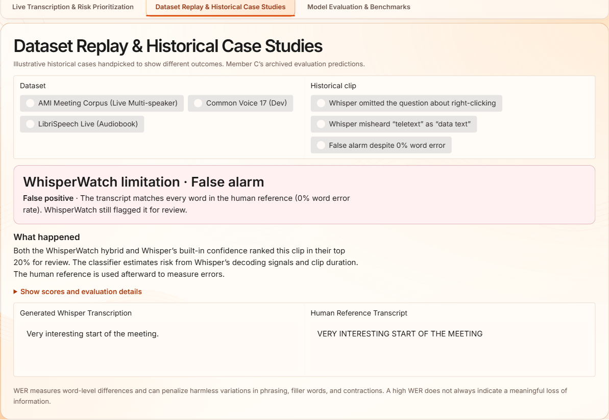

<h1 align="center">
  
</h1>

<p align="center"><strong>Which captions should a human check first?</strong></p>
<p align="center"><em>Veritas AI International High School Hackathon 2026 · Languages track</em></p>

Automatic captions save time, but checking every line can still take hours. WhisperWatch helps subtitle editors decide where to start when they can only review a fraction of their clips.

Upload a short English recording and Whisper turns it into text. A model we trained estimates how likely the transcript is to have substantial word errors. For a batch of clips, the app can combine that estimate with Whisper’s own confidence signals to build a review queue. The editor can then listen to the recordings and make the final call.

## What we added

We built a review queue for subtitle editors who can check one in five clips. Our question was whether a trained model adds anything beyond Whisper’s own confidence.

## How it works

We trained on about 1.09 million English Common Voice clips from Whispered, selecting compatible recordings up to 30 seconds. Human transcripts helped label past errors. New recordings are scored using Whisper’s own signals and information such as clip length.

## See a real false alarm

WhisperWatch queued this clip for review even though every word matched the human transcript. Dataset Replay shows both versions and explains the decision.



In another case, Whisper wrote **“data text”** instead of **“teletext,”** and the combined ranking missed it.

## What we found

We tested four ways of choosing clips on the same set of 750 AMI meeting recordings. Each method could send just 150 clips to a human reviewer. The full set contained 256 high-error transcripts, defined as having a word error rate above 20% when compared with a human transcript.

| How clips were chosen | High-error clips found |
| --- | ---: |
| Random selection | 52 |
| WhisperWatch’s trained model | 85 |
| Whisper’s built-in confidence | 89 |
| Both scores combined | 91 |

Each way of prioritizing clips caught more errors than random selection on this test. **Any added benefit over Whisper’s built-in confidence remains unproven.** The combined score caught two more high-error clips on this meeting test and one fewer on a separate meeting test. The observed differences were small and inconsistent.

## What we’d do next

We evaluated English speech without separate accent results. We’d test across more speakers and accents, then measure whether the review queue saves subtitle editors time.

## Try the interface

Run **Dataset Replay** and **Model Evaluation** from any checkout with Python 3.12.

```bash
python -m pip install "gradio==5.50.0"
python app.py
```

Live uploads use the team’s verified classifier ZIP. With that file, you can [run the full app locally](ui/README.md#live-audio-uploads) or [launch it on a Colab T4 GPU](https://colab.research.google.com/github/idotpixel/Whisperwatch/blob/main/notebooks/backend_colab.ipynb). The Colab host uploads the model once. People visiting the Gradio link can then upload audio from their browsers.

## Credits

- **Training and evaluation data** — [Common Voice 17 records in Whispered](https://huggingface.co/datasets/burakaydinofficial/Whispered), [AMI Meeting Corpus](https://huggingface.co/datasets/edinburghcstr/ami), and [LibriSpeech](https://www.openslr.org/12/).
- **Speech recognition** — [OpenAI Whisper](https://github.com/openai/whisper) and [Systran’s faster-whisper Large V3 model](https://huggingface.co/Systran/faster-whisper-large-v3).
- **Development tools** — [Gradio](https://www.gradio.app/), [scikit-learn](https://scikit-learn.org/), [Google Colab](https://colab.research.google.com/), [OpenAI Codex](https://github.com/openai/codex), and [Google Antigravity](https://antigravity.google/).
