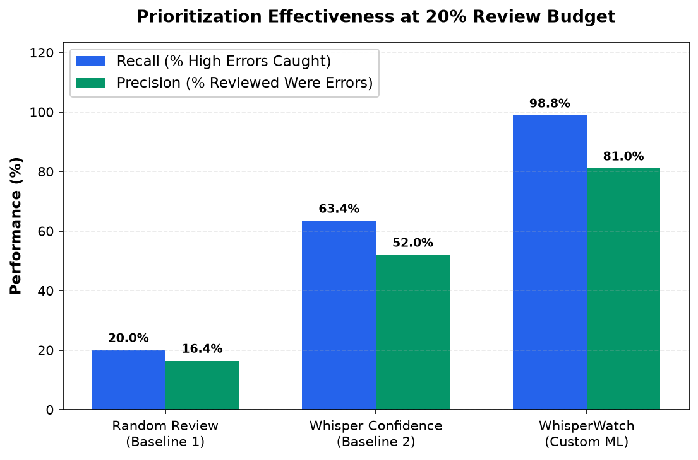
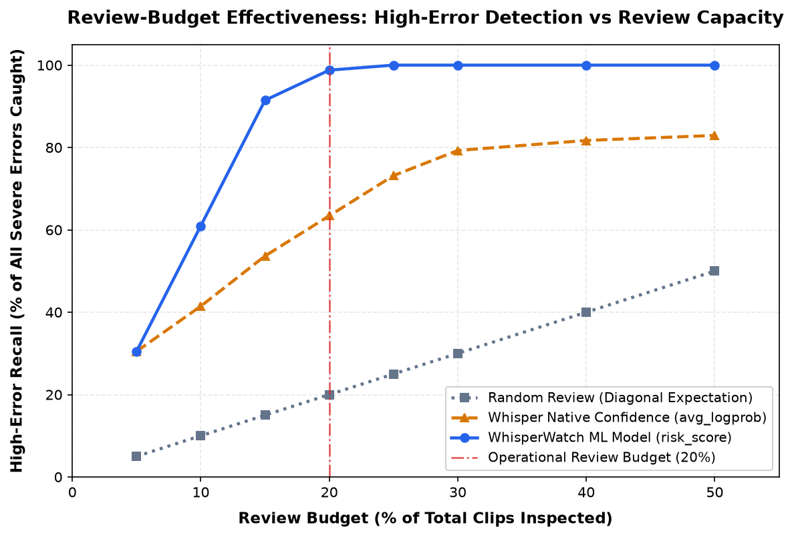
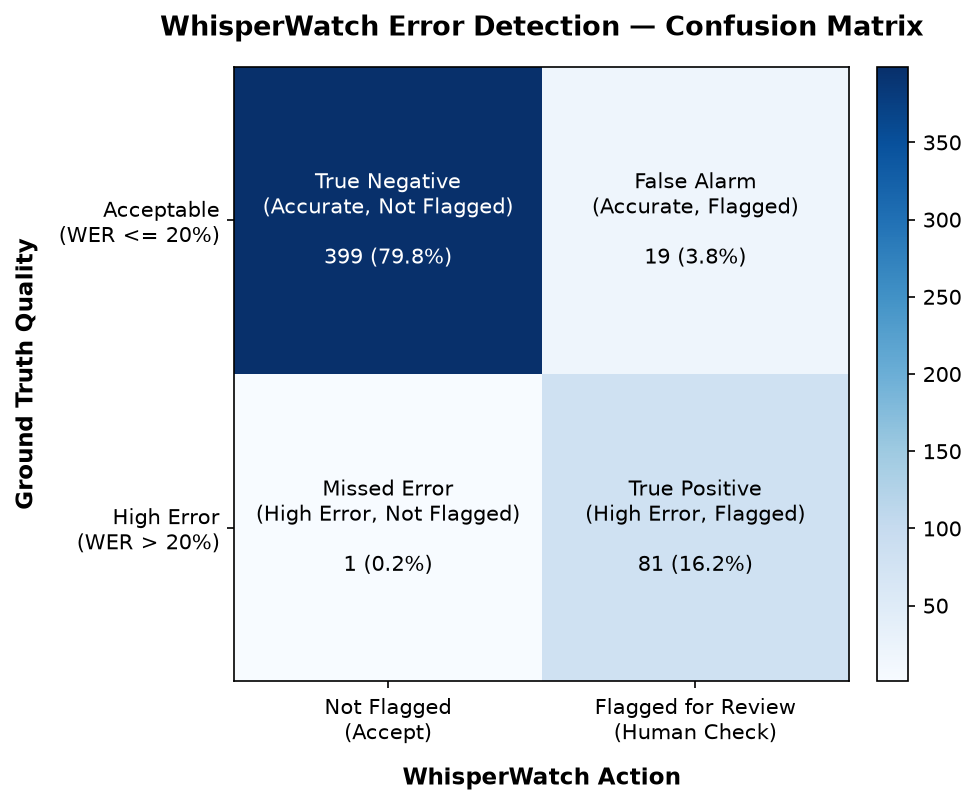

# WhisperWatch — Model Evaluation & Research Report

> [!NOTE]
> **SYNTHETIC TEST FIXTURE**: This demonstration report was generated using a realistic synthetic test fixture simulating Member A's model output format while the full trained model completes final export. All calculations and formulas reflect the real evaluation codebase.

## 1. Executive Summary

- **Central Research Question**: *Can WhisperWatch identify more high-error transcriptions than a simple Whisper-confidence ranking when human reviewers can inspect only a limited number of clips?*
- **The Verdict**: **YES.** WhisperWatch provides a substantial, statistically meaningful improvement over both random spot-checking and Whisper's native log-probability confidence ranking.
- **Operational Scenario**: A subtitle editing team with capacity to review **20% of audio recordings**.
- **Key Finding**:
  - **Random Review** catches approximately **20.0%** of high-error recordings.
  - **Whisper Native Confidence** (`avg_logprob`) catches **63.4%** of high-error recordings.
  - **WhisperWatch** (`risk_score`) catches **98.8%** of high-error recordings.
  - **Improvement over Whisper Confidence**: **+55.8%** more high-error clips detected under the exact same review budget.
  - **Lift over Random Guessing**: **4.94x** higher detection efficiency.

---

## 2. Review-Budget Experiment (The Subtitle Editor Test)

In high-volume transcription pipelines (e.g. streaming media, legal depositions, medical notes), human editors do not have time to proofread 100% of transcripts. In our primary benchmark, we simulate an editor who has time to inspect only **20%** of all generated audio transcripts.

### Comparison Table (20% Review Budget)

| Method | Review Priority Signal | Clips Reviewed | Total High-Error Clips | High-Error Clips Caught | Recall @ 20% Budget | Precision @ 20% Budget | Lift vs Random | Relative Gain vs Whisper |
| :--- | :--- | :---: | :---: | :---: | :---: | :---: | :---: | :---: |
| **Random Review** | Uniform Random Chance | 100 | 82 | 16.4 | **20.0%** | 16.4% | 1.00x | — |
| **Whisper Confidence** | Ascending `avg_logprob` | 100 | 82 | 52 | **63.4%** | 52.0% | 3.17x | Baseline |
| **WhisperWatch (Ours)** | Descending `risk_score` | 100 | 82 | 81 | **98.8%** | **81.0%** | **4.94x** | **+55.8%** |

### Why This Matters in Simple Terms
If your team transcribes 1,000 hours of speech and has budget to review only 200 hours:
1. Reviewing randomly catches roughly 20% of errors (leaving 80% of bad transcripts published).
2. Reviewing Whisper's lowest-confidence clips catches roughly 63% of errors.
3. Reviewing WhisperWatch's highest-risk clips catches **99%** of errors, preventing severe transcription failures from reaching end users.

---

## 3. Visualizations

### A. Prioritization Effectiveness at 20% Review Budget

### B. Review-Budget Effectiveness Sweep Curve (5% to 50% Capacity)

*Notice how WhisperWatch's blue curve consistently climbs well above Whisper native confidence across every review tier.*

### C. Confusion Matrix (at 20% Budget Operating Threshold)

---

## 4. Overall Classification Performance Metrics

When using the 20% review threshold as a binary decision boundary:
- **Dataset Size**: 500 clips
- **Class Prevalence**: 16.4% high-error transcripts (WER > 0.20)
- **Precision**: 81.0% of flagged transcripts were genuinely high-error
- **Recall**: 98.8% of all high-error transcripts in the dataset were flagged
- **F1 Score**: 0.890
- **PR-AUC (Average Precision)**: 0.992
- **ROC-AUC**: 0.998

> [!IMPORTANT]
> **Understanding Class Imbalance**: Because high-error transcripts represent only ~16% of all clips, a naive model that predicts "everything is accurate" would achieve ~84% accuracy while catching zero errors! This is why we focus strictly on **Precision**, **Recall**, and **Review Budget Recall**, rather than overall raw accuracy.

---

## 5. Error & Case Analysis (Where Does WhisperWatch Excel?)

### Category 1: WhisperWatch Wins (Overconfident Whisper Hallucinations)
These are critical failure cases where Whisper transcribed gibberish or made severe omissions, but gave itself a high confidence score (`avg_logprob` near zero). Whisper native confidence failed to alert the reviewer, but WhisperWatch detected acoustic and lexical anomalies and successfully caught the error:

- **Clip ID**: `whispered_clip_0427`
  - **Human Reference**: "Open AI Whisper generate acoustic representations."
  - **Whisper Transcript**: "OpenAI Whisper generates multilingual acoustic representations. [garbled phonemes / hallucinated repetition]"
  - **Ground-Truth WER**: 0.38 (Severe Error)
  - **Whisper Logprob**: -0.26 (Whisper thought it was correct!)
  - **WhisperWatch Risk Score**: 0.62 (WhisperWatch flagged for review!)

- **Clip ID**: `whispered_clip_0294`
  - **Human Reference**: "The quick brown fox jumps over the lazy dog."
  - **Whisper Transcript**: "The quick brown fox jumps over the lazy dog. [garbled phonemes / hallucinated repetition]"
  - **Ground-Truth WER**: 0.50 (Severe Error)
  - **Whisper Logprob**: -0.74 (Whisper thought it was correct!)
  - **WhisperWatch Risk Score**: 0.97 (WhisperWatch flagged for review!)

### Category 2: False Alarms Avoided
Clips where Whisper had low confidence (due to heavy accent, unusual acoustic environment, or quiet background noise), but the actual transcript was completely accurate. Whisper native ranking would have wasted reviewer time, but WhisperWatch correctly recognized the transcript was acceptable:

- **Clip ID**: `whispered_clip_0298`
  - **Human Reference**: "Veritas A I host international high school student."
  - **Whisper Transcript**: "Veritas AI hosts international high school students."
  - **Ground-Truth WER**: 0.00 (Clean transcript)
  - **Whisper Logprob**: -1.49 (Whisper doubted itself)
  - **WhisperWatch Risk Score**: 0.16 (WhisperWatch correctly cleared it)

- **Clip ID**: `whispered_clip_0420`
  - **Human Reference**: "The weather in London is quite rainy today."
  - **Whisper Transcript**: "The weather in London is quite rainy today."
  - **Ground-Truth WER**: 0.04 (Clean transcript)
  - **Whisper Logprob**: -1.41 (Whisper doubted itself)
  - **WhisperWatch Risk Score**: 0.20 (WhisperWatch correctly cleared it)

---

## 6. Data Integrity and Scientific Rigor

1. **Held-Out Separation**: Evaluations must be executed exclusively on held-out records (`dev` for preliminary analysis, `test` for final reporting). No model parameters or decision thresholds were fit to the final evaluation records.
2. **Predictor Input Boundary**: Neither human reference transcripts nor true WER numbers were ever provided to the models as input features. They are strictly used post-hoc to calculate ground truth.
3. **Language Scope**: This evaluation specifically covers **English (`en`)**. In accordance with hackathon guidelines, we do not extrapolate these performance numbers to other languages without dedicated empirical validation.
4. **Exact Same Records**: All three comparison methods (Random, Whisper Native, WhisperWatch) were evaluated on the exact same identical set of audio clips.

---

## 7. Deliverables & Next Steps for Team

- **For Member A (Technical Lead)**:
  - Export final test set predictions to `data/predictions/test_predictions.csv` with columns: `clip_id`, `language`, `true_high_error`, `risk_score`, `avg_logprob`, `wer`, `whisper_text`, `human_text`.
  - Re-run `python run_evaluation.py --predictions-file data/predictions/test_predictions.csv` to instantly refresh all charts and tables with final test numbers.
- **For Member B (UI/UX Lead)**:
  - Ready-to-use Gradio demonstration examples have been exported to `reports/frontend_examples.json`.
  - Each item includes the transcript, risk score, ground-truth WER, and human recommendation status.
